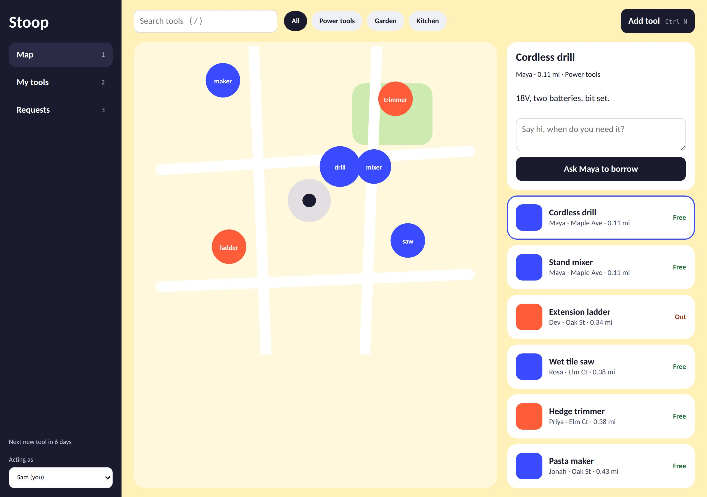

# Stoop: A neighborhood tool-borrowing tracker

Neighborhood tool-lending, as a Django app in a native desktop window.

    pip install -r requirements.txt
    python run_desktop.py

The launcher migrates the SQLite DB, seeds demo neighbors, starts Django on a free
local port and opens it in a pywebview window (falls back to your browser).
Dev mode: `python manage.py makemigrations lending && python manage.py migrate && python manage.py runserver`.

Shortcuts: `/` search, `Ctrl/Cmd N` add tool, `1`-`6` switch views (Map, My tools, Requests, Gazette, Wanted, Hall of Fame).

New in this version:
- **Live town**: neighbors and townsfolk (dots) random-walk the streets in real time, stop to chat, and react to Gazette news. Click a dot to hear it talk (clicking a neighbor waves at them). Pause / speed / rush hour controls under the map.
- **Town Gazette**: a live feed (polled every 5s) of everything that happens, written as silly headlines, plus a ticker in the sidebar.
- **Due dates**: pick how long you want to keep a tool; overdue loans get escalating shame text and the owner can send a Nudge.
- **Wanted board**: post "I need a ___" and neighbors can answer "I've got one!".
- **Hall of Fame**: karma, ranks and badges like The Lendlord and Overdue Gremlin.
- Funny toasts and empty states everywhere (all in `jokes.py`).

File map (flat repo -> package layout): `models/views/views_extra/seed/jokes/gazette/awards/admin/apps/__init__` -> `lending/`, `lending_urls.py` -> `lending/urls.py`, `settings/urls/wsgi` -> `stoop_project/`, `index.html` -> `lending/templates/lending/`, `app.js/app.css/screens.js/town.js` -> `lending/static/lending/`.
Tests: `node town.test.js` (simulation only).

Draft limits: one local database and an "Acting as" switcher stand in for real accounts.
Next steps: auth + a hosted sync server so neighbors share data, photos, due dates, packaging with PyInstaller.
